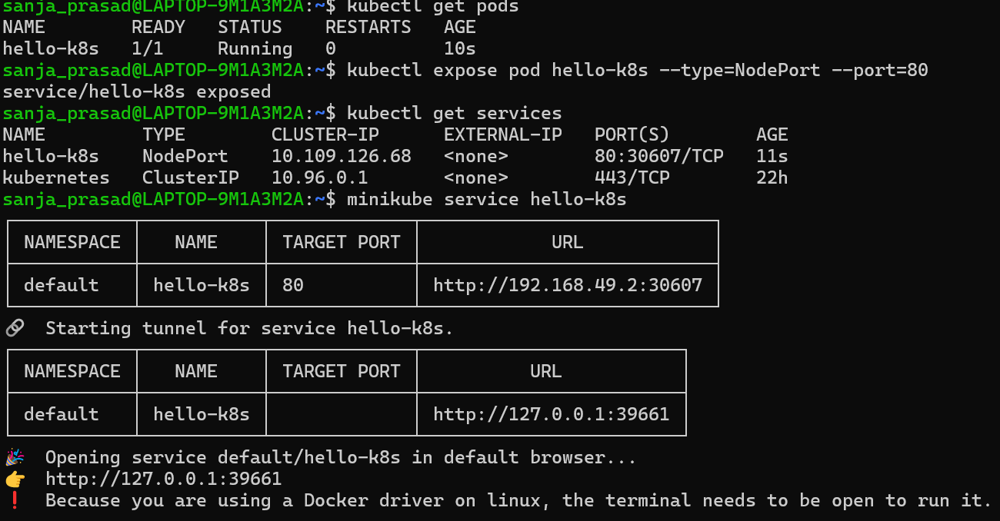
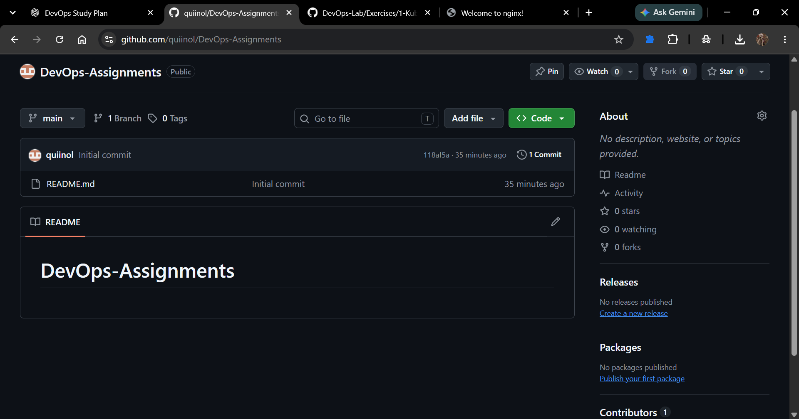

# Exercise 1: Kubernetes - Hello Pod

## 1. Business Problem

Imagine working as a DevOps Engineer at Zepto. The product team has developed a lightweight web application to display the storefront and delivery status. The application needs to run reliably inside Kubernetes and be accessible through a web browser.

For this exercise, Nginx is used to simulate the web application.

## 2. Objective

- Start a local Kubernetes cluster using Minikube.
- Deploy an Nginx container inside a Kubernetes Pod.
- Verify that the Pod is running.
- Expose the Pod through a NodePort Service.
- Access the Nginx welcome page using a browser.

## 3. Tools Used

- Kubernetes
- Minikube
- kubectl
- Docker
- Nginx
- Ubuntu on WSL

## 4. Concepts Learned

### Pod
A Pod is the smallest deployable unit in Kubernetes. It can contain one or more containers. In this exercise, the Pod named `hello-k8s` runs the Nginx container.

### Container Image
The `nginx` image provides the web server software used to serve the default welcome page.

### Service
A Kubernetes Service provides a stable way to access a Pod.

### NodePort
NodePort exposes a Service through a port on the Kubernetes node. In this exercise, Kubernetes assigned NodePort `30607`.

### Minikube
Minikube runs a local Kubernetes cluster for learning and development.

### kubectl
kubectl is the command-line tool used to interact with the Kubernetes cluster.

## 5. Implementation Steps

### Step 1: Start the Kubernetes Cluster

```bash
minikube start --driver=docker
```

Result: Minikube started successfully and the Kubernetes node reached the Ready state.

### Step 2: Create the Pod

```bash
kubectl run hello-k8s --image=nginx --port=80
```

Result: The Pod `hello-k8s` was created successfully.

### Step 3: Verify the Pod

```bash
kubectl get pods
```

Result: Pod `hello-k8s` reached `Running` status, showed `1/1` ready, and had `0` restarts.

### Step 4: Expose the Pod as a NodePort Service

```bash
kubectl expose pod hello-k8s --type=NodePort --port=80
```

Result: The Service `hello-k8s` was created successfully.

### Step 5: Verify the Service

```bash
kubectl get services
```

Result: The Service type was `NodePort`, with Service port `80` and assigned NodePort `30607`.

### Step 6: Access the Application

```bash
minikube service hello-k8s
```

Result: Minikube opened a local tunnel, and the browser displayed the **Welcome to nginx!** page.

## 6. Evidence and Screenshots

### Pod and Service Verification



### Nginx Welcome Page



## 7. Conclusion

Successfully created and verified a Kubernetes Pod running Nginx, exposed it through a NodePort Service, and accessed the Nginx welcome page through a web browser.
