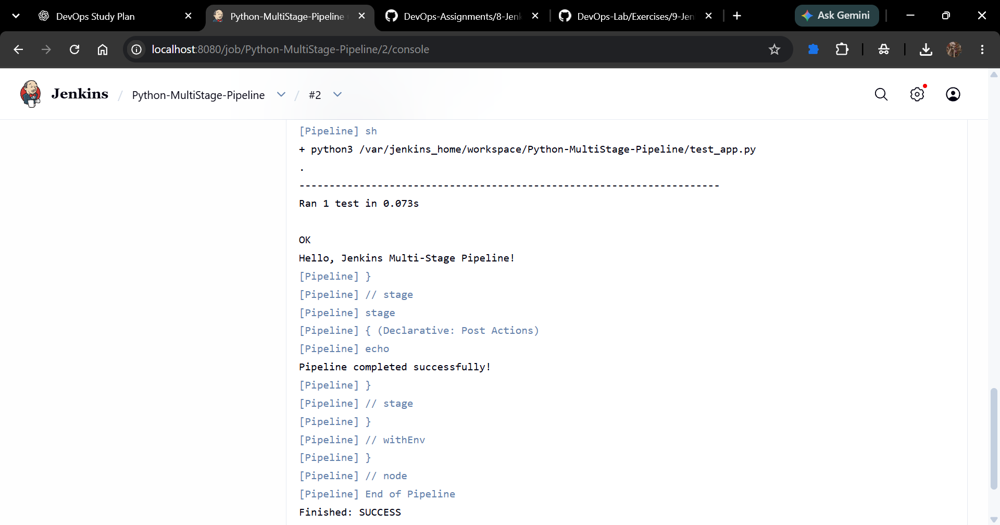
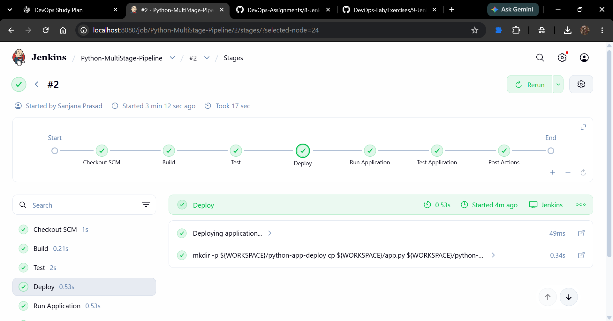

# Assignment 9: Jenkins Multi-Stage Pipeline

## Objective
To create a Jenkins Pipeline that automates the Build, Test, Deploy, Run Application, and Test Application stages for a Python Flask application.

## Tools and Technologies
- Jenkins
- Python 3
- Flask
- Git and GitHub
- Jenkins Pipeline

## Application Files
- `app.py` — Flask application that returns `Hello, Jenkins Multi-Stage Pipeline!`
- `requirements.txt` — Specifies the Flask dependency.
- `test_app.py` — Unit test that verifies the application's response and HTTP status code.
- `Jenkinsfile` — Defines the Jenkins pipeline stages.

## Pipeline Stages
1. **Build:** Displays the build-stage message.
2. **Test:** Runs the Python unit tests using `python3 -m unittest discover -s .`.
3. **Deploy:** Creates the `python-app-deploy` directory and copies `app.py` into it.
4. **Run Application:** Starts the Flask application in the background and saves its process ID.
5. **Test Application:** Runs `test_app.py` to verify the application's response.

## Execution and Results
The pipeline was configured in Jenkins using Pipeline script from SCM, with the GitHub repository as the source and `Jenkinsfile` as the script path.

The pipeline completed successfully. The unit test passed, and the application returned the expected message:

`Hello, Jenkins Multi-Stage Pipeline!`

**Build Status:** SUCCESS

## Screenshots
### Successful Pipeline Console Output

### Jenkins Stage View

